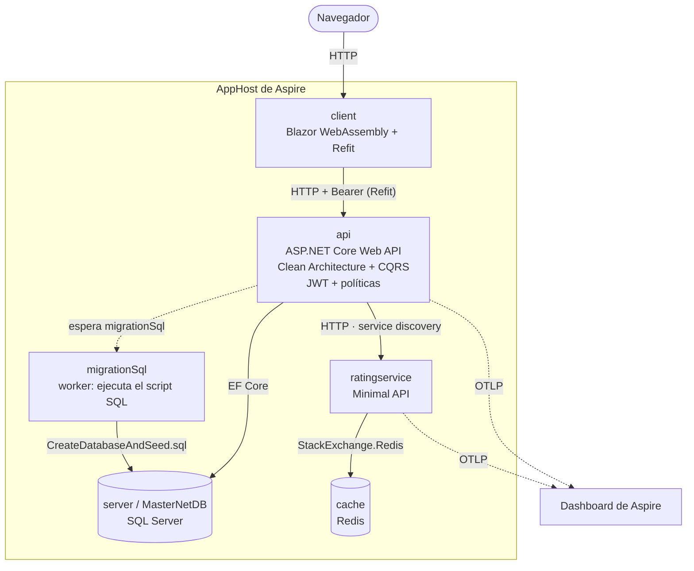

# MasterNet — catálogo de cursos con .NET Aspire

[](https://github.com/arielzamora/aspire-net10-microservices/actions/workflows/ci.yml)

Solución .NET 10 orquestada con .NET Aspire que muestra una arquitectura distribuida completa: Web API con Clean Architecture y
CQRS, cliente Blazor WebAssembly, SQL Server, Redis y un servicio de calificaciones. Desde el cliente se pueden listar, crear,
editar y borrar cursos. Incluye observabilidad con OpenTelemetry, health checks y tests en dos enfoques.

<!-- Captura del dashboard de Aspire con trazas: agregar docs/img/dashboard-trazas.png y descomentar la línea siguiente.

-->



Más diagramas (contexto C4 y local vs. Azure) en [docs/diagramas.md](docs/diagramas.md).

## Stack

.NET 10 · .NET Aspire 13 · ASP.NET Core Web API · Blazor WebAssembly · Refit · EF Core (SQL Server) · Redis ·
OpenTelemetry · xUnit, Moq y `Aspire.Hosting.Testing`.

La capa de aplicación usa un mediador y un mapeador propios (`libs/Core.MediatOR`, `libs/Core.Mappy`).

## Requisitos

- [.NET 10 SDK](https://dotnet.microsoft.com/download)
- Docker Desktop **en ejecución** (Aspire levanta SQL Server y Redis como contenedores)
- Opcional: la CLI de Aspire (comando `aspire`) para usar `aspire run`. Sin la CLI alcanza con `dotnet run` o con F5 en Visual Studio.

## Cómo correrlo

```bash
aspire run
```

Alternativas equivalentes: `dotnet run --project src/MasterNet.AppHost`, o abrir `MasterNet.sln` en Visual Studio y ejecutar el proyecto `MasterNet.AppHost`.

### El único paso manual (solo la primera vez)

La contraseña del usuario administrador de prueba **no está en el repositorio**: la elegís vos.

1. Al arrancar, el dashboard de Aspire (la URL aparece en la consola) muestra el aviso **"Parámetros sin resolver"**.
2. Pulsá **"Especifique los valores"**, escribí una contraseña para `seed-admin-password`
   (mínimo 6 caracteres, con mayúscula, minúscula y número) y marcá **"Guardar en secretos de usuario"**.
3. Pulsá **Guardar**. La API arranca y no te lo vuelve a pedir.

Equivalente por consola, antes de arrancar:

```bash
dotnet user-secrets set "Parameters:seed-admin-password" "<tu-contraseña>" --project src/MasterNet.AppHost
```

Todo lo demás **se genera solo** y queda en los user-secrets del AppHost: la contraseña de SQL Server (`server-password`),
la de Redis (`cache-password`) y la clave de firma de los JWT (`token-key`). No hace falta tocar ningún archivo de configuración.

## Usar la aplicación

| Qué | Dónde |
|---|---|
| Dashboard de Aspire (recursos, logs, trazas) | URL de la consola al arrancar |
| Cliente Blazor | recurso `client` del dashboard (normalmente `http://localhost:5289`) |
| API | `http://localhost:5001/api/courses` |

Usuarios de prueba (se crean al arrancar la API en Development, con la contraseña que elegiste):

| Usuario | Rol | Puede |
|---|---|---|
| `azamora@gmail.com` | ADMIN | listar, crear, editar y borrar cursos |
| `john.doe@gmail.com` | CLIENT | solo lectura |

En el cliente entrá por **Sign in**; con el admin aparecen los botones **New course**, **Edit** y **Delete**.

> La base de datos se **recrea en cada arranque** del AppHost (`Database/CreateDatabaseAndSeed.sql`), así que los cursos que crees no persisten entre ejecuciones.

## Base del curso / Extensiones propias

**Base del curso** (lo que cubre el curso en el que se apoya esta solución):

- AppHost y ServiceDefaults; orquestación de servicios, Redis y SQL Server, service discovery.
- Migraciones de base de datos de tres formas: Docker, EF Core y scripts SQL ([ADR 0005](docs/adr/0005-estrategia-de-migraciones.md)).
- OpenTelemetry: logs, métricas y trazas en el dashboard de Aspire ([ADR 0002](docs/adr/0002-observabilidad-opentelemetry.md)).
- Health checks ([ADR 0003](docs/adr/0003-health-checks-liveness-y-readiness.md)).
- Lifecycle eventing del AppHost y eventing sobre un recurso ([ADR 0004](docs/adr/0004-lifecycle-eventing-vs-migration-worker.md)).
- Tests de integración de dos formas: `WebApplicationFactory` y `Aspire.Hosting.Testing` ([ADR 0006](docs/adr/0006-estrategia-de-testing.md)).
- Backend de cursos con comandos de alta, actualización y baja, y un cliente Blazor que solo listaba.

**Extensiones propias** (agregadas sobre esa base):

- Alta, edición y baja de cursos en Blazor, con validación y confirmación al borrar.
- Login mínimo con JWT en el cliente y políticas en la API ([ADR 0009](docs/adr/0009-autenticacion-y-autorizacion.md)).
- Secretos como parámetros de Aspire, generados o pedidos al primer arranque, sin nada versionado ([ADR 0008](docs/adr/0008-gestion-de-secretos.md)).
- Respuesta `404` en la actualización de un curso inexistente y validación de la actualización.
- Tests de los endpoints de cursos, tests unitarios de los handlers y un flujo de punta a punta con el AppHost completo.
- Limpieza de restos del template, ADRs y diagramas.

### Demos del curso que se conservan

| Qué | Para qué sirve |
|---|---|
| `GET /Demo/getstring`, `GET /Demo/Environment` | Ejemplo de controller y de configuración por entorno (`MyVariable`) |
| `GET /make-healthy`, `GET /make-unhealthy` + `MyHealtCheck` | Cambian a mano el estado del health check para ver cómo reacciona Aspire |
| `GET /api/devices`, `/api/ratings` | Ejemplos de especificaciones de consulta y de llamada al `RatingService` |
| `MasterNet.MigrationService` (EF Core) | Alternativa de migración con EF; está comentada en el AppHost |
| `docker-compose.yml` | Migración con Docker, sin Aspire |
| `SubscribeToAppHostEvents` / `SubscribeToResourcetEvents` | Eventos del ciclo de vida del AppHost (solo escriben logs) |

## Testing

| | Tradicional (`WebApplicationFactory`) | `Aspire.Hosting.Testing` |
|---|---|---|
| Alcance | Un servicio, in-process | Toda la topología del AppHost, out-of-process |
| Dependencias | Reemplazables: DI, mocks, base en memoria o Testcontainers | Reales: los mismos contenedores que en local |
| Control interno | Alto (se puede intervenir el contenedor de DI) | Caja negra: solo por HTTP y estado de los recursos |
| Velocidad | Rápido | Más lento; requiere Docker |
| Qué valida | Lógica y contrato de una API | Cableado real y orden de arranque |

Estrategia: muchos tests tradicionales y unitarios para la lógica y los contratos; pocos tests con `Aspire.Hosting.Testing` para los flujos de punta a punta.

| Suite | Dónde | Comando |
|---|---|---|
| Unitarios (handlers, validadores, behavior) | `tests/MasterNet.Application.UnitTests` | `dotnet test tests/MasterNet.Application.UnitTests` |
| Integración tradicional (endpoints de cursos) | `tests/MasterNet.IntegrationTests/Traditional` | `dotnet test tests/MasterNet.IntegrationTests --filter "FullyQualifiedName~Traditional"` |
| Integración con Aspire (listar → crear → editar → ver) | `tests/MasterNet.IntegrationTests/AspireTesting` | `dotnet test tests/MasterNet.IntegrationTests --filter "FullyQualifiedName~AspireTesting"` |

- Todo junto: `dotnet test`.
- Los tests de Aspire requieren Docker; la primera vez pueden tardar por la descarga de imágenes (timeout de 180 s).
- No necesitan configuración previa: generan sus propias claves y contraseñas.
- **CI:** [`.github/workflows/ci.yml`](.github/workflows/ci.yml) compila y corre las tres suites como pasos separados
  (unitarios, integración tradicional e integración con Aspire), en cada push a `main` y en cada pull request,
  así se ve cuál falla y cuánto tarda cada una.

## Despliegue a Azure (preparado, aún sin ejecutar)

La solución está lista para publicarse en Azure Container Apps con `azd`, pero **todavía no se desplegó**: no hay recursos creados
y el workflow de despliegue está desactivado.

| Pieza | Qué es |
|---|---|
| `azure.yaml` + `infra/` | Infraestructura como código generada con `azd infra gen` (Bicep): Container Apps + registro de imágenes, **Azure SQL** (oferta gratuita, serverless con auto-pausa, solo autenticación Entra ID) y Redis como contenedor (demo). |
| `src/MasterNet.AppHost/AppHost.cs` | En modo publicación usa Azure SQL y Container Apps; en local no cambia nada. `api`, `ratingservice` y `client` escalan a cero. |
| `src/MasterNet.Client/Dockerfile` | El cliente Blazor WebAssembly se publica como contenedor nginx; la URL de la API se inyecta al arrancar (`API_URL`). |
| `.github/workflows/deploy.yml` | Despliegue con OIDC federado (sin secretos en GitHub). Corre los tests antes de desplegar. Desactivado. |

Para regenerar la infraestructura después de cambiar el AppHost: `azd infra gen --force`.

### Activar el despliegue a Azure

Hoy no es un paso para "dar clic": falta una pieza. Orden previsto:

1. Instalar `azd` y la CLI de Azure, e iniciar sesión (`azd auth login`). Hace falta poder crear una identidad federada en Entra ID y asignar roles en la suscripción.
2. Resolver las **migraciones**: en Azure no corre el worker del AppHost. El paso "Migraciones" de `deploy.yml` falla a propósito hasta que se implemente
   (script idempotente o bundle de EF Core; el acceso del runner a Azure SQL y la coincidencia de la migración con el modelo están pendientes, ver [ADR 0005](docs/adr/0005-estrategia-de-migraciones.md)).
3. Decidir cómo se crea el **primer administrador**: el seed de usuarios solo corre en Development.
4. Elegir región y nombre de entorno, y ejecutar `azd pipeline config` (crea la credencial federada y las variables `AZURE_*` del repositorio; si ofrece generar su propio workflow, no lo sobrescribas).
5. Activar el workflow: `gh variable set DEPLOY_TO_AZURE --body true` y lanzar **Deploy** a mano. Cuando funcione, descomentar el disparador `push` de `deploy.yml`.

Costos: Azure SQL gratuito con auto-pausa, Container Apps escalando a cero y un registro de contenedores; es barato pero no gratis (Redis siempre encendido).
Para borrarlo todo: `azd down`.

## Documentación

- [Decisiones de arquitectura (ADRs)](docs/adr/README.md)
- [Diagramas](docs/diagramas.md)

## Configuración opcional

- **Fotos de cursos (Cloudinary):** sin credenciales el alta funciona, pero no sube fotos.
  `dotnet user-secrets set "CloudinarySettings:CloudName" "..." --project src/MasterNet.WebApi` (idem `ApiKey` y `ApiSecret`).
- **SQL Server con `docker-compose`** (sin Aspire): copiá `.env.example` a `.env`, poné un valor en `SA_PASSWORD` y ejecutá `docker compose up`.
- **Ejecutar `MasterNet.WebApi` solo, sin el AppHost:** necesita `TokenKey` y `SeedAdmin:Password` en sus user-secrets
  (`dotnet user-secrets set "TokenKey" "<32+ caracteres>" --project src/MasterNet.WebApi`) y una cadena de conexión `MasterNetDB`.

## Secretos

No hay secretos versionados. En desarrollo se guardan en user-secrets (los genera o los pide Aspire); en Azure serán parámetros del despliegue.

## Qué cambiaría para producción

- **Autenticación:** validar emisor y audiencia del JWT, acortar su vigencia (hoy 7 días) y agregar refresh token; guardar el token del cliente con un esquema más robusto que `sessionStorage`.
- **CORS:** hoy permite cualquier origen; restringirlo al dominio del cliente.
- **Base de datos:** el script actual **borra y recrea** la base en cada arranque. En producción usar un script idempotente o un bundle de EF Core ([ADR 0005](docs/adr/0005-estrategia-de-migraciones.md)) y Azure SQL ([ADR 0007](docs/adr/0007-sql-server-local-y-azure-sql.md)).
- **Usuarios:** el seed de usuarios de prueba solo corre en Development; en producción el primer administrador debe aprovisionarse por otro camino.
- **Health checks:** ya se exponen fuera de Development solo con `HealthChecks:Expose` y sin detalle, y los endpoints de demo `make-healthy`/`make-unhealthy` responden 404 ([ADR 0003](docs/adr/0003-health-checks-liveness-y-readiness.md)); queda proteger los de demo del curso (`/Demo/...`) si se publican.
- **Secretos:** parámetros del despliegue y Managed Identity en lugar de user-secrets; rotar el `TokenKey` que quedó en el primer commit.
- **Redis:** el contenedor pierde su estado; para algo más que una demo, un servicio administrado.
- **Observabilidad:** activar el exportador de Azure Monitor / Application Insights y registrar las fuentes de los workers de migración ([ADR 0002](docs/adr/0002-observabilidad-opentelemetry.md)).

## Roadmap

- 🚧 **Siguiente:** activar el despliegue a Azure Container Apps (infraestructura y workflow ya preparados; faltan las migraciones y el primer administrador, ver "Despliegue a Azure").
- Mensajería: publicar `CourseChanged` con RabbitMQ o Azure Service Bus y transactional outbox.
- gRPC para la comunicación interna entre servicios.
- Integración opcional con Azure AI Foundry en C#.
