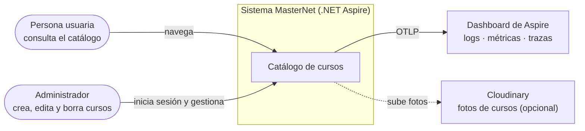
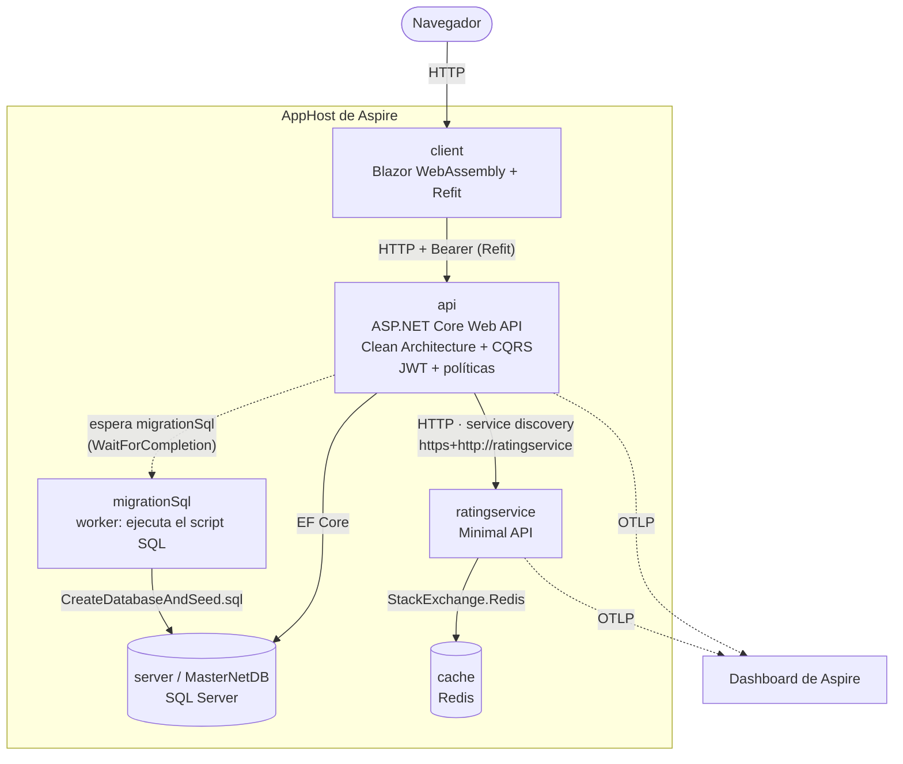
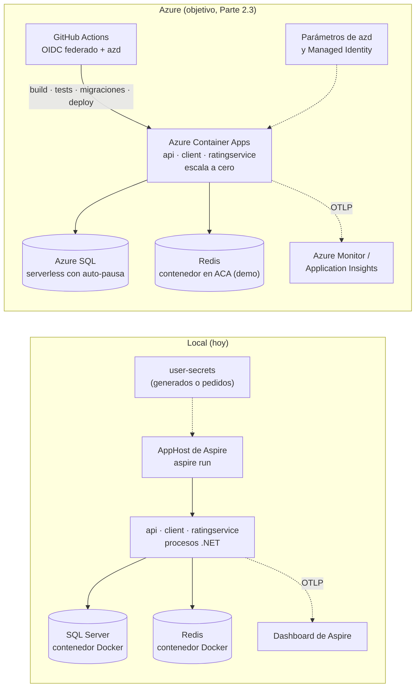

# Diagramas

Diagramas en Mermaid (GitHub los renderiza). Siguen la notación de los niveles C4 (contexto y contenedores) con diagramas de flujo.

## C4 — Contexto

## C4 — Contenedores

## Local vs. Azure

El lado Azure es el **objetivo de la Parte 2.3** y todavía no está implementado.

